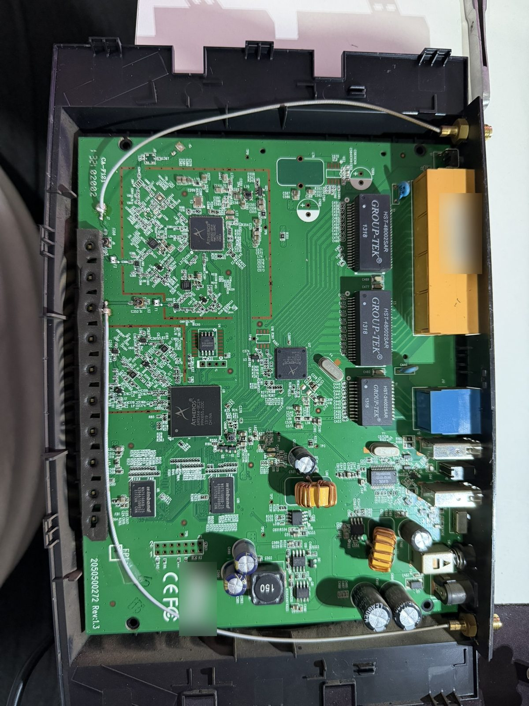
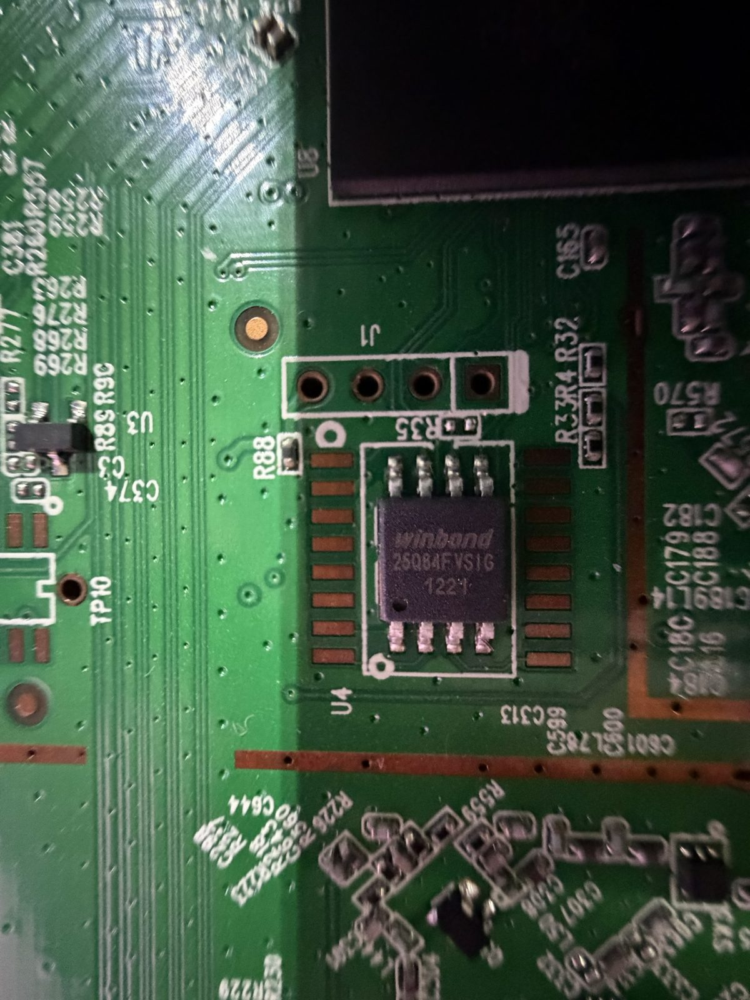
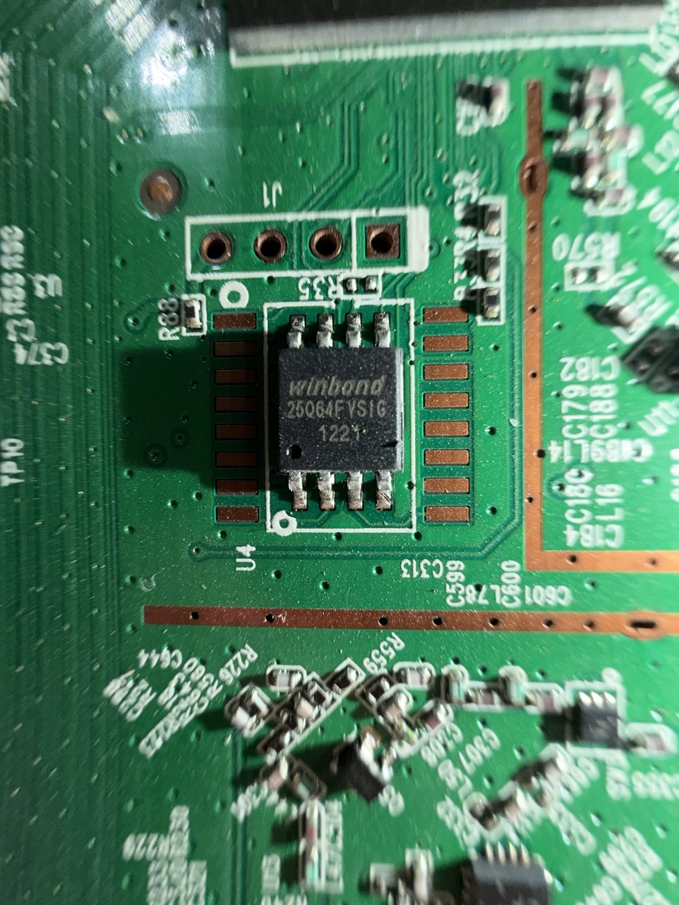
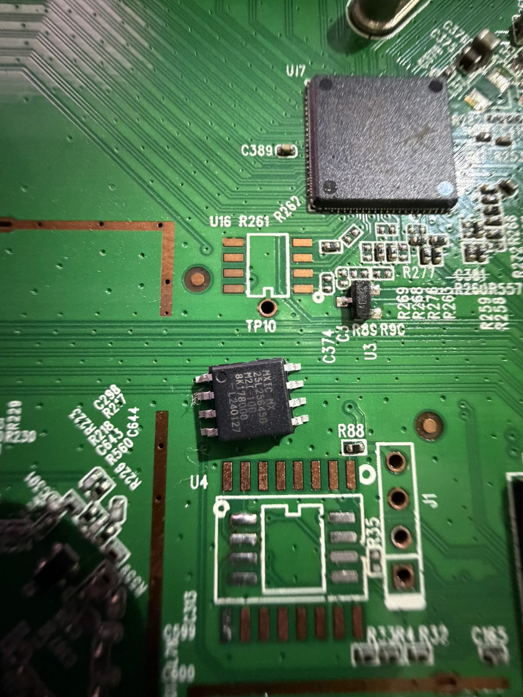
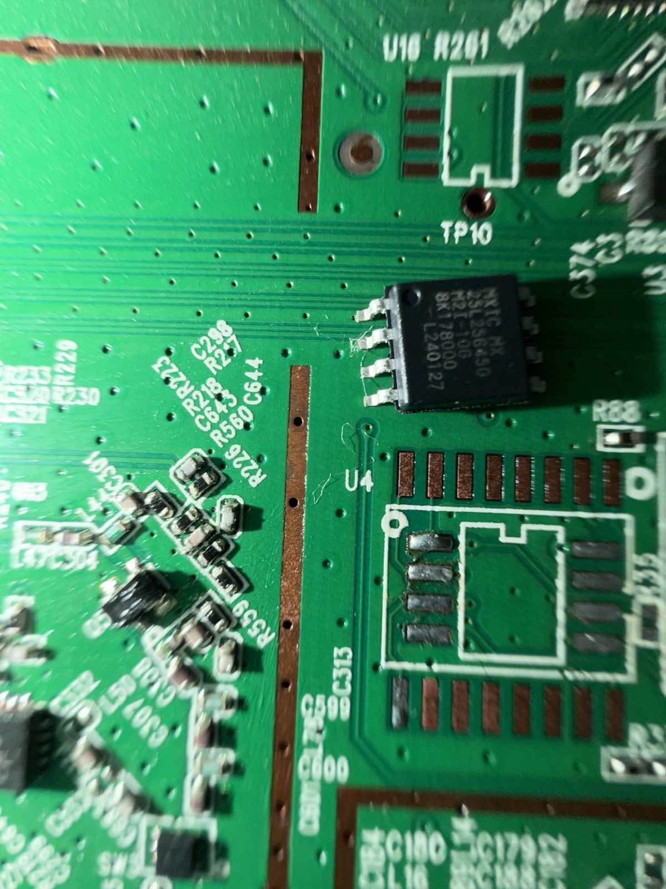
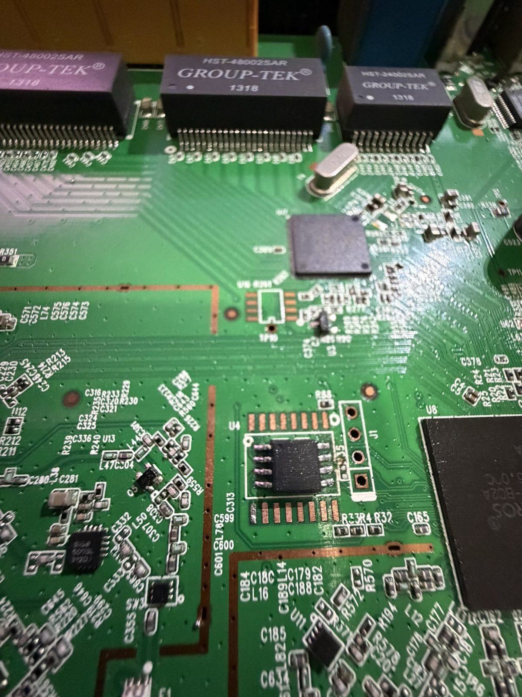
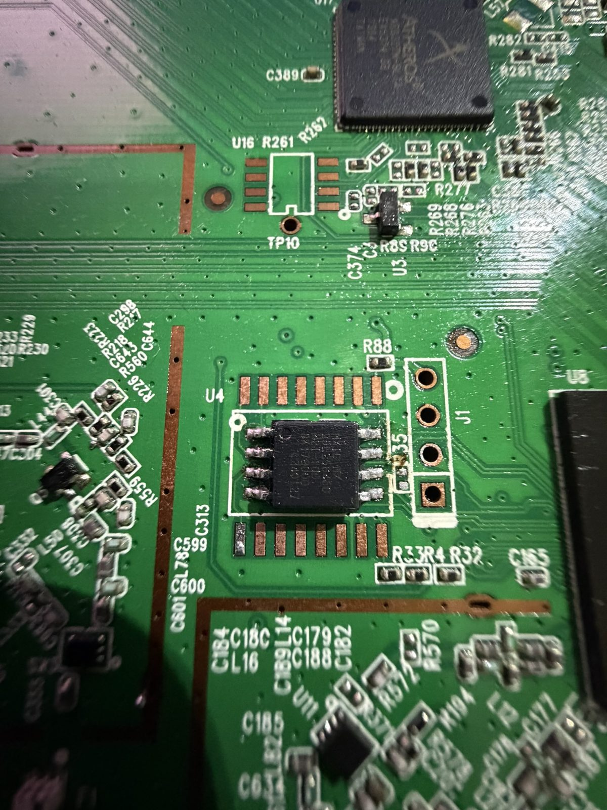
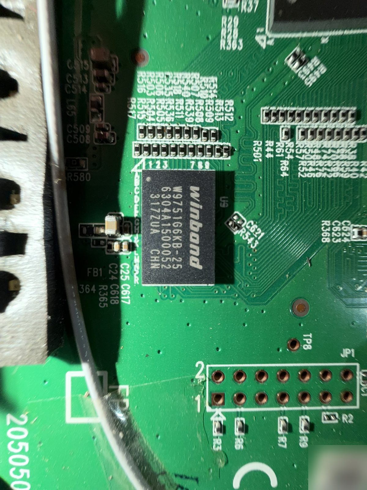
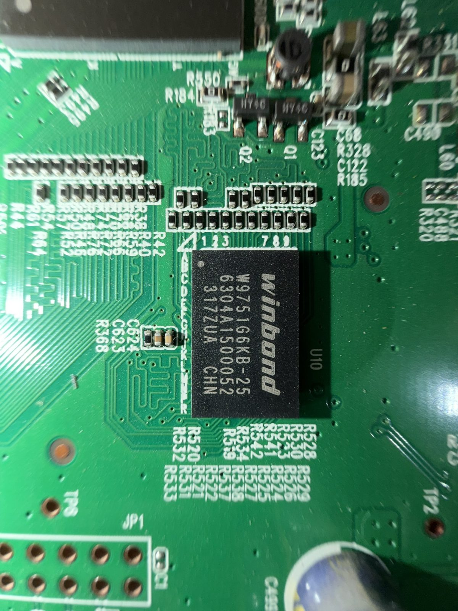
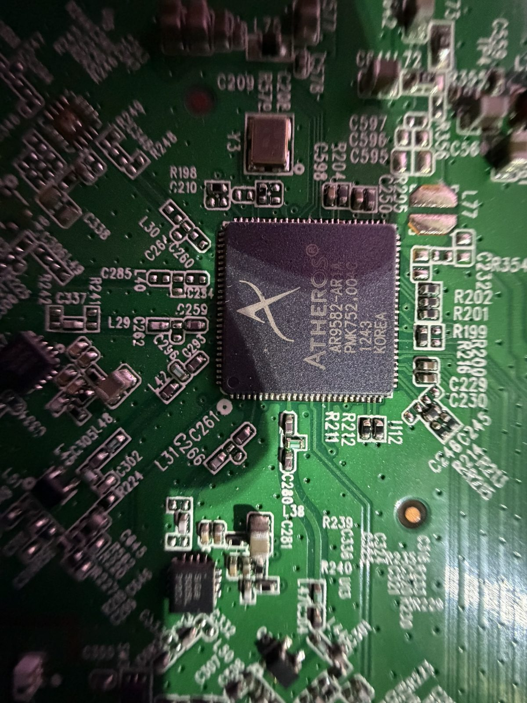

# wdr3600-32mb-openwrt-AVCI v1.0

**TP-Link TL-WDR3600 v1.4 — 32 MB flash modu, OpenWrt 23.05.5 + Breed**

Flash çipi 8 MB'tan **32 MB'a** (Macronix MX25L25645G) yükseltilmiş TL-WDR3600 v1 için
tekrarlanabilir OpenWrt derlemesi, flaşlama araçları ve uzakta (fiziksel erişim olmadan) çalışmak
üzere hazırlanmış kurtarma/izleme düzeni.

> ⚠️ **Yalnızca flash çipi 32 MB'a yükseltilmiş ve Breed bootloader yüklü WDR3600 v1 içindir.**
> Stok 8 MB cihaza yazmayın. Donanım değişikliği (SOP-8 çip sökme/lehimleme, CH341A programlama)
> tamamen sizin sorumluluğunuzdadır.



## İçindekiler

- [Neler yapıldı](#neler-yapıldı)
- [Flash düzeni](#flash-düzeni)
- [Donanım fotoğrafları](#donanım-fotoğrafları)
- [Hazır imaj (Release)](#hazır-imaj-release)
- [İlk açılış: güvenlik uyarısı](#ilk-açılış-güvenlik-uyarısı)
- [Kurulum yolları](#kurulum-yolları)
- [Kendin derle](#kendin-derle)
- [Uzakta çalışma: kurtarma zinciri](#uzakta-çalışma-kurtarma-zinciri)
- [Telegram botu](#telegram-botu)
- [Tailscale / ZeroTier](#tailscale--zerotier)
- [Paketler](#paketler)
- [Testler ve ölçümler](#testler-ve-ölçümler)
- [Bilinen sınırlar](#bilinen-sınırlar)
- [Lisans ve teşekkür](#lisans-ve-teşekkür)

## Neler yapıldı

* **32 MB flash:** stok Winbond 25Q64 (8 MB) yerine Macronix **MX25L25645G** (32 MB, SOP-8).
  Kernel çipi tam boy görür: `spi-nor spi0.0: mx25l25635e (32768 Kbytes)`.
* **Bootloader:** Breed (r1337, AR9344/AR8327N yapısı). 32 MB'ı ve 4-byte adreslemeyi doğal tanır, web
  kurtarma arayüzü vardır.
* **4-byte sorunu çözüldü:** Linux çipi 4-byte modda bırakırsa işlemcinin Boot ROM'u yeniden başlatmada
  Breed'i okuyamaz ve cihaz takılır. Çözüm iki katmanlı:
  1. MX25L25645G kalıcı mod değiştirmeden 4-byte komutlarını (0x13/0x12/0xDC) kabul eder; Linux 5.15 SFDP
     üzerinden bunu kullanır.
  2. Breed env'de `autoboot.command=flash dump 0x20000 16; autoboot`: açılışta flash'ı güvenli moda alır.
* **DTB/ART düzeltmesi:** ImageBuilder çekirdeği derlemez, hazır `kernel.bin` içindeki DTB'yi kullanır.
  `patch_dtb.py`, DTB'yi `dtc` ile açıp yalnızca flash bölümlerini değiştirir (firmware `0x20000+0x1fd0000`,
  **ART `0x1ff0000`**) ve `fdtget` ile doğrular. Böylece Wi-Fi kalibrasyonu doğru yerden okunur
  (önceki bayt yaması yanlışlıkla çekirdek kodunu değiştirmişti).
* **mktplinkfw `32Mlzma` düzeni** (fw_max_len `0x1fd0000`), yalnızca bu cihaz tanımına uygulanır.
* **Doğrulama:** `verify_image.py`; vmlinux'un stokla bayt bayt aynı olduğunu, DTB bölümlerini ve tahmini
  `/overlay` boyutunu kontrol eder. Kişisel ve genel imaj: **TAMAM**.
* **Uzakta çalışma:** internet/modem/Tailscale/ZeroTier kurtarma zinciri, reboot nedeni kaydı, Telegram
  bildirimleri ve çok kullanıcılı bot (aşağıda).

## Flash düzeni

| Adres | Boyut | Bölüm |
|---|---|---|
| `0x0000000` | 128 KB | Breed (+ env `0x1e000`, MAC `0x1fc00`) |
| `0x0020000` | 31.8 MB | firmware (kernel + squashfs rootfs + jffs2 `/overlay`) |
| `0x1ff0000` | 64 KB | ART (Wi-Fi kalibrasyonu, cihaza özel) |

Rootfs ~21.5 MB (xz, salt okunur, tüm paketler içinde), `/overlay` ~7.4 MB yazılabilir alan.
LuCI'deki "Disk space" yalnızca `/overlay`'i gösterir.

## Donanım fotoğrafları

| | |
|---|---|
|  |  |
| Stok flash: Winbond 25Q64FVSIG (8 MB), U4 | Yakın görünüm |
|  |  |
| Yeni çip: Macronix MX25L25645G (32 MB), lehim öncesi | Çip üzerindeki yazı |
|  |  |
| U4'e lehimlenmiş 32 MB çip | Yakın görünüm |
|  |  |
| RAM: 2 × Winbond W9751G6KB-25 (toplam 128 MB DDR2) | |
|  | |
| 5 GHz radyo: Atheros AR9582 | |

Fotoğraflardaki seri numarası etiketleri bulanıklaştırıldı, konum (EXIF) verisi temizlendi.

## Hazır imaj (Release)

[Releases](../../releases) sayfasında **v1.0**:

| Dosya | Ne için |
|---|---|
| `wdr3600-32mb-openwrt-AVCI-v1.0-sysupgrade.bin` | Çalışan 32 MB OpenWrt'den: LuCI > Firmware yükselt ("Ayarları koru" işaretsiz) veya `sysupgrade -n` |
| `wdr3600-32mb-openwrt-AVCI-v1.0-factory.bin` | Breed web arayüzünden yazmak için |
| `sha256sums` | `sha256sum -c sha256sums` |

İmajda **şifre, Wi-Fi anahtarı, MAC, ART veya herhangi bir kişisel kimlik yoktur**
(rootfs açılıp taranarak doğrulandı).

## İlk açılış: güvenlik uyarısı

> 🔓 **Genel imaj ilk açılışta açık gelir:**
> * Wi-Fi **"AVCI"** (2.4 + 5 GHz), **şifresiz**
> * root şifresi **boş**
>
> Hemen **http://192.168.1.1** adresine girip **Sistem > Yönetim**'den root şifresi ve
> **Ağ > Kablosuz**'dan Wi-Fi şifresi (WPA2) koyun.

Varsayılanlar: LAN `192.168.1.1`, DHCP açık, hostname `Wdr3600-AVCI`, saat dilimi Europe/Istanbul, tema
bootstrap (klasik). 2.4 GHz HT20 17 dBm, 5 GHz HT40 (kanal 36+40), ülke TR. IPv6 OpenWrt varsayılanında.

## Kurulum yolları

**A) Breed web arayüzü (en kolay):** WPS/Reset basılıyken güç ver → `http://192.168.1.1` →
Firmware update → `...-factory.bin`.

**B) Breed telnet betiği (Windows):** `scripts/breed/breed_flash_clean.bat` (yönetici). İmajı ve cihazın
kendi `art.bin`'ini aynı klasöre koyun. Firmware bölümünü siler, yazar, geri okuyarak doğrular; ART yalnızca
farklıysa yazılır; Breed env'de `autoboot.command` yoksa ekler (env kapalıysa `breed_bootfix.bat`).

**C) CH341A ile tam çip (boş/bozuk çip için):** `build32/make_fullflash.py` 32 MiB'lik tam imaj üretir:
Breed + env + MAC + OpenWrt + ART, aradaki her şey 0xFF (ilk açılışta `/overlay` temiz kurulur).

```bash
python3 build32/make_fullflash.py --breed breed-ar9344-ar8327n.bin --mac aa:bb:cc:dd:ee:ff \
    --art kendi_art_yedeginiz.bin --firmware wdr3600-32mb-openwrt-AVCI-v1.0-sysupgrade.bin -o fullflash.bin
```

* **Breed bu depoda yok** (lisansı belirsiz). Kaynak: https://breed.hackpascal.net/ →
  `breed-ar9344-ar8327n.bin` (r1337, 2021-12-15), sha256
  `4f30f85e6622245c86d446b071224cd3ab714b1b9fee3275063fbdd82345aba7`. Farklıysa betik durur.
* **ART ve MAC cihaza özeldir:** stok çipin son 64 KB'ı (`0x7f0000`) ve etiketteki MAC. Başka cihazın ART'ı
  Wi-Fi'yi bozar. Çipi değiştirmeden önce **mutlaka tam yedek alın.**

## Kendin derle

WSL/Ubuntu (ImageBuilder Linux dosya sisteminde çalışır):

```bash
sudo apt install build-essential libncurses-dev zlib1g-dev gawk git gettext libssl-dev \
    xsltproc rsync wget unzip python3 file device-tree-compiler patch curl xz-utils
bash build32/build.sh
```

Adımlar: ImageBuilder 23.05.5 indir + sha256 → her seferinde sıfırdan aç → stok `kernel.bin`'i bayt bayt
yeniden üreterek tarifi doğrula → DTB'yi 32 MB'a yamala → `mktplinkfw` 32Mlzma derle → `make image`
(`packages-full.txt`, `files_public/`) → `verify_image.py`. FILES klasörü Linux tarafında temiz izinlerle
(644/755/600) kopyalanır (NTFS'ten gelen 777 sorunu).

Ayarlanabilir: `FILES_DIR=... PACKAGES_FILE=... OUT=... bash build32/build.sh`

## Uzakta çalışma: kurtarma zinciri

İnternet kesildiğinde:

| Süre | Ne olur | Kim |
|---|---|---|
| 5 dk | 4G modem yeniden başlatılır (Huawei B618; sonra en az 10 dk arayla) | `huawei_watchdog` (kişisel kurulum) |
| 15 dk | WAN yenilenir | `uzak-bekci.sh` |
| 20 dk | Ağ yeniden başlatılır | `uzak-bekci.sh` |
| 30 dk | Router reboot (açılıştan sonra 30 dk dolmadan asla) | watchcat (`run_script`) |

* İnternet varken Tailscale veya ZeroTier takılırsa 10 dk'da o servis yeniden başlatılır; ikisi birden 30 dk
  ulaşılamazsa reboot. Döngü koruması: her bekçi reboot'unda bekleme ikiye katlanır (en fazla 6 sa).
* Donanım watchdog'u açık (kernel donarsa 30 sn).
* Reboot nedeni reboot'tan önce kaydedilir; açılışta Telegram'a bildirilir (`bekçi`, `watchcat`,
  `Telegram komutu` ya da *beklenmedik: elektrik kesintisi*).
* Saatlik sağlık kaydı `/tmp/saglik.log`, günlük özet `/etc/saglik-ozet.log`.
* NTP önce IP adresli sunucular (saat yanlışken DoH çalışmaz), NTP eşitlenince DoH yeniden bağlanır.

## Telegram botu

Genel imajda Telegram/Huawei botu **yoktur**; bildirim betikleri (`tg-bildir.sh`, `tg-gonder.sh`) vardır
ve ayar boşsa sessizce hiçbir şey yapmaz. Kişisel kurulumdaki bot:

* Çok kullanıcılı: kullanıcı/grup ID listesi (bildirim + `/status`, `/signal`), ayrı yönetici listesi
  (`/router_reboot`, `/reboot`, `/band`, `/sms`).
* **Reboot döngüsü koruması:** her mesaj işlenmeden önce Telegram'a onaylanır; saat eşitlenmeden komut
  işlenmez; açılıştan önce yazılmış mesajlar yok sayılır; açılıştan sonraki ilk 3 dk `/router_reboot` reddedilir.
* İsteğe bağlı (pasif) eWeLink modülü: Sonoff'ları eWeLink'teki adlarıyla yönetme
  ("ön ışıkları aç"). Kurulum: [docs/EWELINK_KURULUM_ADIMLARI.md](docs/EWELINK_KURULUM_ADIMLARI.md).

Token ve ID'ler yalnızca router'daki 600 izinli ayar dosyasında durur; betiklerde ve loglarda yoktur.

## Tailscale / ZeroTier

* **Tailscale:** kurulu, açılışta başlar, giriş yapılmamış. Alt ağ için hazır (tailscale arayüzü + firewall
  bölgesi, nftables modu):
  ```sh
  tailscale up --advertise-routes=192.168.1.0/24 --accept-dns=false
  ```
  Admin panelinde rotayı onaylayın, isterseniz "Disable key expiry". Evdeki (aynı LAN'daki) bilgisayarlarda
  "Use Tailscale subnets" kapalı olmalı, yoksa trafik tünele girer ve router DNS/reklam engellemesi atlanır.
* **ZeroTier:** kurulu ama **kapalı**. Paketin örnek ayarı herkese açık "Earth" ağına katılır; genel imajda
  bu örnek ilk açılışta silinir. Kendi ağınızı ekleyip `zt+` arayüzünü bilinçli olarak bir firewall
  bölgesine koyun.

## Paketler

`build32/packages-full.txt`: LuCI (bootstrap), SQM/cake, WireGuard, https-dns-proxy (DoH), adblock-fast
(OISD small + gawk/grep/sed/coreutils-sort), zram-swap (+kmod-lib-lzo), Tailscale, ZeroTier, Samba4, UPnP,
ttyd, statistics/collectd, watchcat, WoL, pbr, nft-qos, USB depolama (ntfs3/exfat), curl/jq/htop/nano/iperf3,
openssl-util. `packages-lean.txt`: hafif liste.

Varsayılan durum: adblock açık, UPnP açık (secure mode), flow offloading açık, SQM hazır ama kapalı
(hızınızı girip açın), nft-qos limitleri kapalı, pbr kapalı.

## Testler ve ölçümler

* 6 × warm reboot (terminal ve Telegram) + soğuk açılış (fiş çek-tak): hepsinde kendiliğinden açıldı.
* Bekçi: gerçek Tailscale durdurma → 10 dk eşiğinde yeniden başlatma + Telegram bildirimi.
* Hız (kablolu, router üzerinden, Cloudflare): ~241 Mbps indirme. Bu hızda CPU (560 MHz MIPS 74Kc) %93'e
  çıkıyor; **~250-300 Mbps donanım sınırı**. Yük altında gecikme artışı yok (SQM gereksiz).
* RAM: 128 MB; tüm servisler + Tailscale girişliyken ~20-30 MB kullanılabilir + 64 MB zram.

## Bilinen sınırlar

* `dmesg`'deki `OF: Bad cell count ... partitions` ve `force read-only` satırları stok OpenWrt'de de vardır, zararsız.
* `luci-app-zerotier` 23.05'te yok.
* Tapo prizler yerel API vermediği için bot ile yönetilmez.
* Büyük paketler için `/overlay` (~7 MB) dar; paketi imaja ekleyip yeniden derleyin.

## Lisans ve teşekkür

Bu depodaki betikler **GPL-2.0** ([LICENSE](LICENSE)). OpenWrt ve firmware-utils kendi lisanslarıyladır.
Breed © HackPascal, bu depoda dağıtılmaz.
